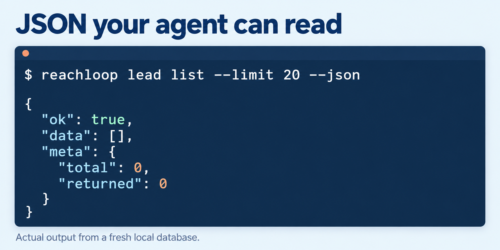

<picture>
  <source media="(prefers-color-scheme: dark)" srcset="assets/logo-dark.svg">
  
</picture>

# Reachloop


Reachloop is a command-line tool for X (Twitter) direct messages that AI coding agents can drive. You install it on your own computer, sign in to X, and let Claude Code or Codex find leads, start outbound conversations, and answer the people who write to you.

- It runs on your computer and stores everything in one SQLite file.
- It sends from your own X account and your own IP address. It has no proxies.
- It has no built-in AI. Your agent writes every message.
- It sends no telemetry.

Status: early development. Expect breaking changes. The current CLI supports lead search, outbound DMs and inbox replies. Campaigns and a background daemon are not implemented yet.

## How it works

Your coding agent calls the CLI. The CLI reads and writes local SQLite data and calls X directly. Cookies use the OS keychain when available, with an owner-only file fallback.

## Before you use it

The [X developer guidelines](https://docs.x.com/developer-guidelines) restrict automated DMs to people who sent you a DM first. Reachloop enables outbound DMs by default; that product setting is not permission from X to send automated cold DMs. Recipient privacy settings and X permissions still apply, and X may restrict or suspend accounts for automation. Use an account you can afford to lose while you try Reachloop, and keep volumes low.

You can turn on reply-only mode per account to restrict sends to people who have already written to that same account. Incoming message requests count.

## Install

Reachloop needs [Bun](https://bun.sh) 1.4.3 or later, on macOS or Linux. Older Bun versions cannot read the checked-in lockfile. Run `bun upgrade` if needed.

```sh
git clone https://github.com/amrtawfik160/reachloop.git
cd reachloop
bun install --frozen-lockfile
bun link
reachloop init
```

## Sign in

Browser sign-in needs Google Chrome or Chromium:

```sh
reachloop account login --browser
```

A Chrome window opens on the X sign-in page. You type your own username and password there. Reachloop never types for you. When X signs you in, Reachloop saves the session cookies and closes the window.

You can also import cookies you exported from a signed-in x.com tab. The file can be a JSON object, a browser-extension cookie export, or a copied `Cookie` header. It needs `auth_token`, `ct0` and `twid`.

```sh
reachloop account add --cookies-file cookies.json
```

Reachloop keeps sessions in the macOS Keychain or the Linux Secret Service. On Linux machines without one, it uses an owner-only file in its data folder. `reachloop doctor` shows which.

## Use it from Claude Code or Codex

```sh
reachloop skill install --agent all
```

This copies the Reachloop skill into `~/.claude/skills/reachloop` and `~/.codex/skills/reachloop`. Restart the agent, then ask it in plain words, for example "find 20 SaaS founders on X with open DMs" or "answer my unread X DMs".

## Use it yourself

```sh
reachloop                                   # accounts, DMs today, leads, unread
reachloop lead search --keyword "saas founder" --open-dm --max 50 --tag founders
reachloop lead import --followers-of @someone --max 200
reachloop lead import --csv leads.csv
reachloop lead list --tag founders
reachloop inbox sync
reachloop inbox list --unread
reachloop inbox show @jane
reachloop inbox send @jane --text "Hi Jane, ..." --yes
reachloop inbox reply @jane --text "Thanks for writing! ..." --yes  # alias for send
reachloop limits show @myaccount
reachloop limits set @myaccount --reply-only on
reachloop limits set @myaccount --dm 75
```

`inbox send` can start a conversation with any handle; saving a lead first is optional. `inbox reply` remains a backward-compatible alias and uses the same account settings. Both require `--yes` to confirm a real send. Add `--account @myaccount` to select the sender. `--dry-run` previews without sending or consuming quota and does not require `--yes`; account/session, cap and optional reply-only checks still apply. For example: `reachloop inbox send @jane --text "Hi Jane, ..." --dry-run`.

Every command accepts `--json` and returns `{"ok": true, "data": ...}` or `{"ok": false, "error": {...}}` with a stable exit code. The full command list and exit codes are in [skills/reachloop/reference/commands.md](skills/reachloop/reference/commands.md).



The illustration shows `reachloop lead list --limit 20 --json` after `reachloop init` on a fresh database. The same output is copyable here:

```sh
reachloop lead list --limit 20 --json
```

```json
{"ok":true,"data":[],"meta":{"total":0,"returned":0}}
```

## Limits

- Reply-only is optional and off by default for existing and new accounts. `reachloop limits set @account --reply-only on` requires a prior inbound DM to that same account; message requests count. Use `--reply-only off` to disable it.
- Each account sends at most 50 DMs a day by default. `reachloop limits set @account --dm N` explicitly changes that account’s cap from 0 to 250. No setting exceeds the hard maximum of 250, and saved caps are never automatically raised.
- `reachloop limits show @account` shows the account’s cap, today’s usage, `replyOnly` and `hardMax: 250`. You can combine `--dm N` and `--reply-only on|off` in one `limits set` command.
- Every send checks confirmation, account/session state and the daily cap. Paused accounts cannot send. The same text to the same person on the same day goes out once, even if the command runs twice.
- Reachloop warns when you add a fourth account, because every account on one computer shares one IP address.

## Where your data lives

`reachloop db path` prints the database location: `~/Library/Application Support/reachloop` on macOS, `~/.local/share/reachloop` on Linux. Set `REACHLOOP_HOME` to move it. The folder and the database are readable only by your user.

## Development

```sh
bun test
bun run typecheck
bun run lint
bun run build        # CI check only: one-file build in dist/, never shipped
```

The default tests never call x.com, launch real Chrome, or access your OS keychain. Browser protocol and credential storage behavior are covered with local fakes.

Run native integration checks explicitly on a machine with Chrome and an unlocked OS keychain:

```sh
REACHLOOP_TEST_CHROME=1 bun test test/signin.test.ts
REACHLOOP_TEST_KEYCHAIN=1 bun test test/secrets.test.ts
```

These checks fail rather than silently skipping when explicitly enabled and their prerequisites are unavailable. The Chrome check uses only a local test page, never your X account.

See [AGENTS.md](AGENTS.md) for the rules agents follow when they change this repo.

## License

MIT. The X client is based on [twikit](https://github.com/d60/twikit) and [Scweet](https://github.com/Altimis/Scweet), both MIT licensed. Their notices are in [THIRD_PARTY_NOTICES.md](THIRD_PARTY_NOTICES.md). The TLS dependency `cycletls` is GPL-3.0. Reachloop ships only as a Bun package, so `cycletls` is installed as a separate package and is never bundled into a Reachloop file.
